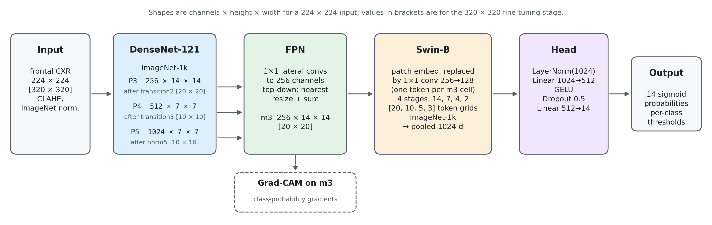
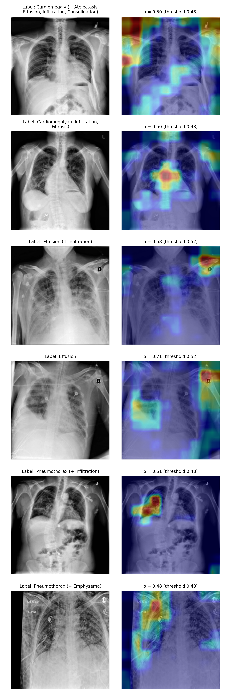

# Hybrid Chest X-Ray Net

**A DenseNet-121 + FPN + Swin-B hybrid for 14-class chest X-ray classification on NIH ChestX-ray14, evaluated against retrained CNN baselines under a leakage-free protocol.**

Research prototype. Not a diagnostic tool.

---

## ⚠️ Corrected results (October 2026)

An earlier version of this repository reported a mean test AUROC of 0.7854. **That number is invalid** and has been withdrawn:

1. **The official test list was used as the validation set**, for early stopping, learning-rate scheduling, checkpoint choice and per-class thresholds.
2. **"No Finding" images (about half the dataset) were never sampled during training**, because of a bug in the sampler weights.
3. **The 320 px stage upsampled 224 px images**, so it added no real detail.

The model was retrained from scratch with these fixed. Everything below comes from the corrected pipeline in [`retrain/`](retrain/).

## 📈 Results

The protocol:
- **Validation:** a patient-wise split, 10% of the train/val patients (seed 42), used for every model-selection decision.
- **Test:** the official NIH test list (25,596 images, 2,797 patients), evaluated once per model.
- **Confidence intervals:** 95%, from 2,000 patient-level bootstrap resamples.

| Run | Model | Loss | Sampler | Input | Test macro AUROC (95% CI) | ECE |
|:--|:--|:--|:--|:--|:--|--:|
| A | Hybrid | ASL | imbalance-aware | 224 | 0.770 (0.763–0.777) | 0.321 |
| B | Hybrid | ASL | none | 224 | 0.774 (0.766–0.781) | 0.306 |
| E | Hybrid (B fine-tuned) | ASL | none | 320 + TTA | 0.790 (0.784–0.796) | 0.307 |
| C | DenseNet-121 | BCE | none | 224 | 0.805 (0.798–0.811) | **0.014** |
| D | DenseNet-121 | ASL | imbalance-aware | 224 | **0.807** (0.800–0.812) | 0.286 |
| T | Hybrid, tuned recipe (fixed before running) | BCE | none | 320 + TTA | 0.803 (0.796–0.810) | 0.016 |

ECE is the expected calibration error, with 10 equal-count bins.

**What this shows:**
- **The hybrid did not beat DenseNet-121.** DenseNet-121 + ASL (D) beat the final hybrid (E) by +0.017 macro AUROC (95% CI +0.012 to +0.021), and was significantly better on 8 of 14 classes and significantly worse on none.
- **A tuned training recipe closed the gap, but didn't beat DenseNet.** The tuned hybrid (T) reached 0.803, statistically tied with DenseNet-121 (D − T = +0.004, 95% CI −0.001 to +0.008), and only at 320 px with test-time augmentation. At 224 px, DenseNet-121 still beat it by +0.009.
- **ASL didn't improve discrimination, and it wrecked calibration.** Swapping BCE for ASL changed DenseNet-121's AUROC by +0.002 (not significant), but its predicted probabilities were about 5× too high.
- **The imbalance-aware sampler slightly hurt the hybrid:** removing it changed AUROC by +0.004.
- **Subgroups:** discrimination was similar across sex and age groups. Sensitivity at fixed thresholds differed for some findings, e.g. cardiomegaly in patients aged 60 or over.

Full tables, per-class results, calibration and subgroup analyses are in the paper (citation to follow).

## 🧠 Architecture

- **DenseNet-121 taps:** after transition2, transition3 and norm5. At 224 px input these are 256×14×14, 512×7×7 and 1024×7×7.
- **FPN:** fuses the three taps into m3, 256×14×14 (20×20 at 320 px).
- **Swin-B:** its patch embedding is replaced by a 1×1 conv (256→128), so each m3 cell becomes one token.
- **Head:** LayerNorm → 1024→512 → GELU → Dropout 0.5 → 14 outputs.

## 🔍 Grad-CAM

Grad-CAM is computed on the FPN output m3. Example images are drawn at random (fixed seed) from the test true positives, not picked by hand. Heatmaps are coarse, so they are a qualitative check, not a localisation result.

## 🚀 Reproducing

The training runs on Kaggle GPUs (T4). See [`retrain/RUNBOOK.md`](retrain/RUNBOOK.md) for the exact commands. The scripts run in this order:

| Script | Runs on | What it does |
|:--|:--|:--|
| `01_build_cache.py` | Kaggle CPU | Downsamples the full-resolution NIH images to a 384 px cache (one zip). |
| `02_train.py` | Kaggle GPU | Trains and evaluates one run, writing predictions, thresholds and history. |
| `03_evaluate.py` | CPU | Bootstrap CIs, paired comparisons, calibration, subgroups, figures. |
| `04_gradcam.py` | CPU | Grad-CAM figure. |

`--paper_dir` in the RUNBOOK commands is optional; it only copies the LaTeX tables and macros for the manuscript.

The original notebook `hybrid_chest_xray_net.ipynb` is kept for reference only. It contains the bugs listed above.

**Split.** `splits/nih_patient_split_seed42.csv` lists every image with its split (train / val / test). Validation is 10% of the official train/val patients (seed 42), and test is the official test list:

| Split | Images | Patients |
|:--|--:|--:|
| Train | 77,719 | 25,207 |
| Validation | 8,805 | 2,801 |
| Test | 25,596 | 2,797 |

`tools/make_architecture_figure.py` draws the architecture figure.

## Data

NIH ChestX-ray14 ([NIH Clinical Center](https://nihcc.app.box.com/v/ChestXray-NIHCC)).

The labels were mined from radiology reports with NLP and are known to be noisy (Oakden-Rayner, 2020). The test metrics therefore measure agreement with those mined labels, not with true findings.

## ⚠️ Limitations

- **Not a medical device.** This is a research prototype. Do not use it for diagnosis.
- **Single institution, single seed.** There was no external validation, and each configuration was trained once.
- **Uncalibrated probabilities.** The ASL-trained models' probabilities are badly miscalibrated, so don't read them as risks.

## 👥 Authors

<table>
  <tr>
    <td align="center"><a href="https://github.com/AnirvanRanjan"> <b>Anirvan Ranjan</b></a></td>
    <td align="center"><a href="https://github.com/Kartiken07"> <b>Kartiken</b></a></td>
  </tr>
</table>
