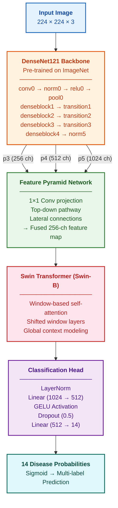

<div align="center">

# Hybrid Chest X-Ray Net

**Multi-label classification of 14 chest pathologies from X-ray images**


A hybrid **DenseNet121 + Swin Transformer** model with Feature Pyramid Networks for detecting multiple diseases in chest X-rays.

```
Mean AUROC: 0.7854 │ 14 Diseases │ Multi-Label Classification
```

---

</div>

## Architecture

<div align="center">



</div>

---

## Sample Predictions

> Add your GradCAM and prediction images here after running the notebook.
>
> ```bash
> # Save outputs from notebook:
> # - learning_history.png
> # - pr_curves.png  
> # - confusion_matrices.png
> # Then place them in an assets/ folder and reference below:
> ```

<div align="center">

<!-- Add your images like this: -->
<!--  -->
<!--  -->

*Run the notebook to generate visualization outputs*

</div>

---

## 14 Disease Classes

<div align="center">

| # | Disease | | # | Disease |
|:-:|:--------|:-:|:-:|:--------|
| 1 | Atelectasis | | 8 | Pneumothorax |
| 2 | Cardiomegaly | | 9 | Consolidation |
| 3 | Effusion | | 10 | Edema |
| 4 | Infiltration | | 11 | Emphysema |
| 5 | Mass | | 12 | Fibrosis |
| 6 | Nodule | | 13 | Pleural Thickening |
| 7 | Pneumonia | | 14 | Hernia |

</div>

---

## Results

<div align="center">

| Disease | AUROC | F1 Score | |
|:--------|------:|---------:|:-:|
| **Hernia** | **0.9319** | 0.4390 | Best |
| **Emphysema** | **0.9013** | **0.4694** | |
| **Pneumothorax** | **0.8492** | 0.4662 | |
| **Cardiomegaly** | **0.8476** | 0.3080 | |
| **Edema** | 0.8293 | 0.2217 | |
| **Effusion** | 0.8172 | **0.5171** | Best F1 |
| **Fibrosis** | 0.7953 | 0.1416 | |
| **Mass** | 0.7734 | 0.3129 | |
| **Pleural Thickening** | 0.7532 | 0.2048 | |
| **Atelectasis** | 0.7387 | 0.3606 | |
| **Consolidation** | 0.7211 | 0.2197 | |
| **Nodule** | 0.7087 | 0.2469 | |
| **Pneumonia** | 0.6703 | 0.0778 | Hardest |
| **Infiltration** | 0.6587 | 0.4349 | |
| **Mean** | **0.7854** | **0.3158** | |

</div>

---

## Key Features

| Feature | Description |
|---------|-------------|
| **Hybrid Architecture** | DenseNet121 CNN + Swin Transformer fused via FPN |
| **Asymmetric Loss** | Down-weights easy negatives for imbalanced data |
| **CLAHE Preprocessing** | Adaptive histogram equalization for better contrast |
| **Progressive Training** | Freeze → Unfreeze → Full fine-tuning |
| **Multi-scale TTA** | Horizontal flip + multi-resolution inference |
| **Threshold Optimization** | Per-class F1-maximized decision boundaries |
| **GradCAM** | Visual explanations for model predictions |

---

## Setup

```bash
# Clone the repo
git clone https://github.com/Kartiken07/hybrid-chest-xray-net.git
cd hybrid-chest-xray-net

# Install dependencies
pip install -r requirements.txt
```

### Run on Kaggle

1. Upload `final - Copy.ipynb` to Kaggle
2. Enable **GPU** (T4) in notebook settings
3. Add the [NIH Chest X-ray dataset](https://www.kaggle.com/datasets/khanfashee/nih-chest-x-ray-14-224x224-resized) as data source
4. Run all cells

---

## Dataset

<div align="center">

[](https://www.kaggle.com/datasets/khanfashee/nih-chest-x-ray-14-224x224-resized)

</div>

---

<div align="center">

**Built with PyTorch**


</div>
