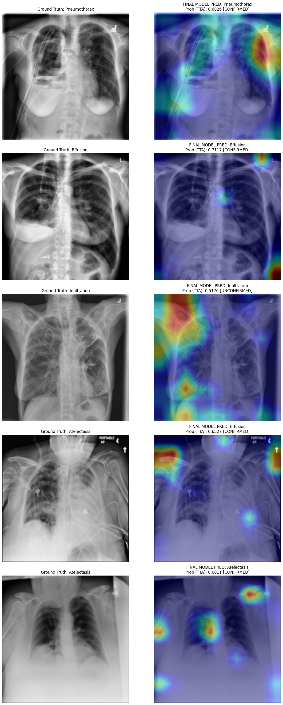
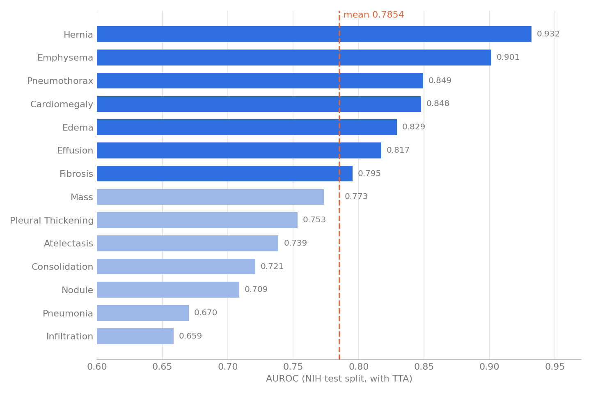
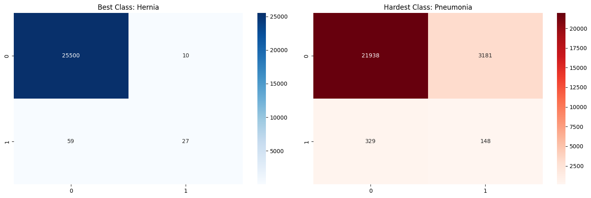
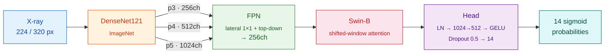

<div align="center">

# 🫁 Hybrid Chest X-Ray Net

**A CNN + Transformer hybrid that reads a chest X-ray and flags 14 thoracic diseases at once.**

DenseNet121 for local texture · Feature Pyramid Network for multi-scale fusion · Swin Transformer for global context

[](https://www.python.org/)
[](https://pytorch.org/)
[](https://www.kaggle.com/datasets/khanfashee/nih-chest-x-ray-14-224x224-resized)
[](https://www.kaggle.com/)

[Results](#-results) · [Architecture](#-architecture) · [Training](#-training-recipe) · [Explainability](#-explainability) · [Quickstart](#-quickstart)

<br/>

| **0.7854** | **0.932** | **14** | **3-view TTA** |
|:---:|:---:|:---:|:---:|
| mean AUROC | best class AUROC (Hernia) | disease labels | flip + multi-scale |

<br/>



<sub>Left: input X-ray with ground truth · Right: model prediction with Grad-CAM attention</sub>

</div>

---

## ✨ Highlights

- **Hybrid backbone.** DenseNet121 feature maps (p3, p4, p5) are fused by an FPN, then passed through Swin-B. Swin's patch embedding is swapped for a 1×1 conv, so the transformer attends over CNN features instead of raw pixels.
- **Built for imbalance.** Asymmetric Loss (γ⁻ = 4, clip = 0.05) plus a `WeightedRandomSampler` handle labels like Hernia, which appears in about 0.2% of images.
- **Progressive unfreezing.** The head trains first, then the transformer unfreezes, then the full network fine-tunes with differential learning rates.
- **Higher-resolution finish.** After the 224px run, the model is fine-tuned at 320×320 with a short cosine-annealed final push.
- **Tuned decisions.** Each class gets its own F1-maximizing threshold instead of a flat 0.5.
- **Explainable.** Grad-CAM heatmaps show where the model is looking.

---

## 📈 Results

Evaluated on the official NIH ChestX-ray14 test split (~25.6k images) with test-time augmentation.

<div align="center">

</div>

<details>
<summary><b>Full per-class table (AUROC, F1, tuned threshold)</b></summary>

<br/>

| Disease | AUROC | F1 | Threshold |
|:--|--:|--:|--:|
| Hernia | **0.9319** | 0.4390 | 0.675 |
| Emphysema | 0.9013 | 0.4694 | 0.605 |
| Pneumothorax | 0.8492 | 0.4662 | 0.502 |
| Cardiomegaly | 0.8476 | 0.3080 | 0.673 |
| Edema | 0.8293 | 0.2217 | 0.512 |
| Effusion | 0.8172 | **0.5171** | 0.541 |
| Fibrosis | 0.7953 | 0.1416 | 0.483 |
| Mass | 0.7734 | 0.3129 | 0.505 |
| Pleural Thickening | 0.7532 | 0.2048 | 0.460 |
| Atelectasis | 0.7387 | 0.3606 | 0.529 |
| Consolidation | 0.7211 | 0.2197 | 0.440 |
| Nodule | 0.7087 | 0.2469 | 0.520 |
| Pneumonia | 0.6703 | 0.0778 | 0.419 |
| Infiltration | 0.6587 | 0.4349 | 0.527 |
| **Mean** | **0.7854** | **0.3158** | |

</details>

<details>
<summary><b>Best vs. hardest class: confusion matrices</b></summary>

<br/>

<div align="center">

</div>

Hernia is rare but visually distinctive, so the model is precise when it fires. Pneumonia overlaps heavily with Infiltration and Consolidation on X-ray, so most of its positives are false alarms.

</details>

---

## 🧠 Architecture



**Why hybrid?** CNNs are strong at local texture (nodules, fibrotic patterns). Transformers capture long-range structure (heart size, bilateral effusions). The FPN gives the transformer features at several scales instead of a single resolution.

---

## 🔧 Training Recipe

| Stage | Resolution | What happens |
|:--|:--:|:--|
| **1 · Warm-up** | 224 | Backbone + Swin frozen for 5 epochs; only the FPN and head learn (lr 1e-4) |
| **2 · Unfreeze** | 224 | Swin unfreezes at epoch 5 and the full network at epoch 8; backbones train at lr 1e-6 |
| **3 · Upscale** | 320 | Fine-tune at 320×320 with CLAHE, flips, ±15° rotation and color jitter |
| **4 · Final push** | 320 | 5 epochs, AdamW lr 2e-6, cosine annealing |
| **5 · Calibrate** | 320 | Per-class threshold search maximizing F1 |

**Shared across stages:** Asymmetric Loss, weighted sampling, AdamW, mixed precision (AMP), ReduceLROnPlateau on validation AUROC (stages 1–2).

**Inference:** the average of three views: original, horizontal flip and 352px upscale.

---

## 🔍 Explainability

Grad-CAM on the final model (figure at the top of this page). Most hits land on plausible regions, but not all of them. In row 4 the model calls Effusion on an Atelectasis case, and several maps light up on text markers and image borders. That's a known shortcut-learning risk with NIH data, and worth reading before trusting any single prediction.

---

## 🚀 Quickstart

**On Kaggle (recommended).** The notebook paths are written for Kaggle.

1. Upload [`hybrid_chest_xray_net.ipynb`](hybrid_chest_xray_net.ipynb) to Kaggle
2. Turn on **GPU T4** in notebook settings
3. Add the [NIH Chest X-ray 224×224 dataset](https://www.kaggle.com/datasets/khanfashee/nih-chest-x-ray-14-224x224-resized) as input
4. **Run all**

**Locally**

```bash
git clone https://github.com/AnirvanRanjan/hybrid-chest-xray-net.git
cd hybrid-chest-xray-net
pip install -r requirements.txt
# then point BASE_PATH in the notebook at your copy of the dataset
```

```
hybrid-chest-xray-net/
├── hybrid_chest_xray_net.ipynb   # model, training, evaluation, Grad-CAM
├── requirements.txt
└── assets/                       # figures used in this README
```

---

## ⚠️ Limitations

- **Not a medical device.** This is a research and learning project. Do not use it for diagnosis.
- **Labels are noisy.** NIH ChestX-ray14 labels were mined from radiology reports by NLP and are known to be noisy.
- **F1 is optimistic.** Checkpoint selection and per-class thresholds were tuned on the same test split that is reported. AUROC is less affected, but the F1 scores would likely drop on a truly held-out set.

---

## 👥 Authors

<table>
  <tr>
    <td align="center"><a href="https://github.com/AnirvanRanjan"><br/><b>Anirvan Ranjan</b></a></td>
    <td align="center"><a href="https://github.com/Kartiken07"><br/><b>Kartiken</b></a></td>
  </tr>
</table>
